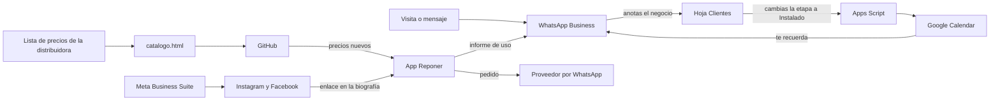

# 6. Automatización

Todo el sistema cuesta **$0 al mes**. Usa cinco herramientas gratuitas y la propia app.

## Qué hace cada herramienta

| Herramienta | Para qué | Costo | Qué automatiza |
|---|---|---|---|
| **Reponer (la app)** | El producto | $0 | Calcula ventas por día, punto de pedido y cantidad; arma el mensaje de pedido; actualiza precios de catálogos; avisa atrasos y pedido mínimo |
| **GitHub Pages** | Publica la app y las páginas de venta | $0 | Cada cambio en la rama `main` se publica solo en 1–2 minutos |
| **GitHub Actions** | Prueba la app | $0 | Corre las pruebas en cada cambio y avisa si algo se rompió |
| **WhatsApp Business** | Ventas y atención | $0 | Mensaje de bienvenida, mensaje de ausencia, respuestas rápidas, etiquetas |
| **Google Sheets + Apps Script** | Registro de clientes | $0 | Embudo calculado solo; crea los recordatorios de seguimiento en tu calendario |
| **Google Calendar** | Agenda | $0 | Te avisa cada seguimiento, cada cobro y la revisión del domingo |
| **Meta Business Suite** | Redes | $0 | Publica en Instagram y Facebook a la hora programada |
| **Canva** | Imágenes | $0 (plan gratuito) | Plantillas reutilizables |

Opcional más adelante: dominio propio. Un `.com.ve` cuesta unos $55 al año en un registrador como OVHcloud; no lo necesitas para empezar.

## Cómo se conectan

## Qué haces tú y qué hace el sistema

| Tarea | Quién |
|---|---|
| Visitar negocios, escuchar, instalar | Tú |
| Calcular cuánto pedir | La app |
| Escribir el pedido al proveedor | La app; el dueño lo envía |
| Responder la primera vez que alguien escribe | WhatsApp, automático |
| Responder preguntas frecuentes | Tú, con una respuesta rápida de dos toques |
| Recordar cada seguimiento | Calendar, creado por el script |
| Contar cuántos clientes hay en cada etapa | La hoja, sola |
| Publicar en redes a la hora indicada | Meta Business Suite |
| Preparar las publicaciones | Tú, 1 hora el domingo |
| Actualizar los precios de una distribuidora | Tú, 15 minutos con `catalogo.html`; llegan solos a las bodegas |
| Cobrar | Tú |

Cerca de la mitad del trabajo queda automatizada. La otra mitad es hablar con personas, y esa no conviene automatizarla al principio.

---

## Configuración paso a paso

Hazlo en este orden. Tiempo total: unas 2 horas y media, una sola vez.

### A. Tu contacto en las páginas de venta (5 minutos)

1. En GitHub, abre el archivo `contacto.js` y toca el lápiz para editar.
2. Entre las comillas de `nombre` escribe tu nombre.
3. Entre las comillas de `whatsapp` escribe tu número con código de país y solo números. Ejemplo: `584121234567`.
4. Si tu zona no es Caracas, cambia `zona`.
5. Toca **Commit changes** y guarda en la rama `main`.
6. En dos minutos, abre `jasu0906.github.io/claude-trabaja-/negocios/` y comprueba que aparece el botón "Pedir mi instalación por WhatsApp".

Mientras el número esté vacío, las páginas no muestran el botón, para que nadie toque un enlace roto.

### B. WhatsApp Business (40 minutos)

Los nombres de los menús pueden variar un poco según la versión.

1. Decide el número. Lo recomendable es una línea distinta a la personal; si no tienes, puedes convertir tu número, pero mezclarás chats personales y de clientes.
2. Instala **WhatsApp Business** desde la tienda de aplicaciones y regístralo con ese número.
3. **Perfil:** Ajustes → Herramientas para la empresa → Perfil de empresa.
   - Nombre: `Reponer`
   - Categoría: Servicio para empresas
   - Descripción: `Te ayudo a que no te falte lo que más vendes. App gratuita para bodegas y abastos.`
   - Sitio web: `https://jasu0906.github.io/claude-trabaja-/`
   - Foto: sube `icon-512.png`.
4. **Mensaje de bienvenida:** Herramientas para la empresa → Mensaje de bienvenida → actívalo y pega el texto de `listo-para-usar/mensajes-whatsapp.md`.
5. **Mensaje de ausencia:** Herramientas para la empresa → Mensaje de ausencia → actívalo, elige "Horario personalizado" y pon tus horas de clase:
   - Lunes 9:00–18:00, martes 8:00–12:00, miércoles 8:00–14:00, jueves 9:00–13:00, viernes 7:00–11:00.
6. **Respuestas rápidas:** Herramientas para la empresa → Respuestas rápidas → toca `+`. Crea una por cada mensaje del archivo, usando el atajo indicado (`como`, `precio`, `gratis`…). Son 19; empieza por las 6 primeras y agrega el resto cuando las necesites.
7. **Etiquetas:** Herramientas para la empresa → Etiquetas. Crea estas, iguales a las etapas de la hoja: `Contactado`, `Entrevistado`, `Interesado`, `Instalado`, `Usa sin ayuda`, `Pagó`, `Distribuidor`.
8. **Catálogo:** Herramientas para la empresa → Catálogo. Agrega tres artículos: "Reponer (gratis)", "Reponer Instalado · $35" y "Acompañamiento · $10 al mes", cada uno con el enlace a `negocios/`.

### C. Hoja de clientes en Google Sheets (15 minutos)

1. Entra a `drive.google.com` con tu cuenta de Google.
2. Nuevo → Subir archivo → elige `negocio/hojas/clientes-y-ventas.xlsx`.
3. Ábrelo y elige Archivo → Guardar como Hojas de cálculo de Google.
4. Borra la fila de ejemplo (fila 5) cuando cargues tu primer cliente real.
5. Agrega el acceso directo a la pantalla de inicio del teléfono: en la app de Hojas de cálculo, menú del archivo → "Agregar a la pantalla principal".

Haz lo mismo con `finanzas.xlsx` para poder cambiar los supuestos.

### D. Recordatorios automáticos con Apps Script (20 minutos)

Este script crea tres recordatorios en tu calendario cada vez que cambias la etapa de un negocio a `Instalado`: seguimiento a los 2 días, pedir el informe a los 7 y ofrecer el Acompañamiento a los 25.

**Aviso:** el código está escrito con las funciones estándar de Google, pero no pude ejecutarlo desde mi entorno. Pruébalo con una fila de ejemplo antes de confiar en él.

1. En la hoja de clientes de Google: Extensiones → Apps Script.
2. Borra lo que aparezca y pega el contenido de `negocio/listo-para-usar/automatizacion-seguimiento.gs`.
3. Toca Guardar (el disquete).
4. En la lista de funciones de arriba elige `instalar` y toca **Ejecutar**.
5. Google te pedirá permiso para ver tus hojas y tu calendario. Acepta: el script solo corre en tu cuenta.
6. Prueba: en la hoja Clientes, cambia la etapa de la fila de ejemplo a `Instalado`. En unos segundos deben aparecer tres eventos en tu Google Calendar.
7. Borra esos tres eventos de prueba.

### E. Google Calendar (10 minutos)

Crea estos eventos que se repiten:

| Evento | Cuándo | Para qué |
|---|---|---|
| Revisión semanal Reponer | Domingos, 1 hora | Mirar el Tablero, programar publicaciones, planear visitas |
| Cobros del mes | Día 1 de cada mes | Enviar `/cobro` a quienes pagan mensual |
| Precios de distribuidoras | Lunes | Enviar `/precios-nuevos` a cada distribuidora |
| Respaldo de mis archivos | Día 15 de cada mes | Descargar una copia de la hoja de clientes |

### F. Instagram y Meta Business Suite (30 minutos)

1. Crea una cuenta de Instagram llamada `reponer.ve` o la variante que esté libre. Conviértela en cuenta profesional: Configuración → Tipo de cuenta → Cambiar a cuenta profesional → Empresa.
2. Biografía: `Que no te falte lo que más vendes. App gratis para bodegas y abastos. Hecha en Venezuela.` Enlace: `https://jasu0906.github.io/claude-trabaja-/`.
3. Crea una página de Facebook con el mismo nombre y vincúlala a la cuenta de Instagram; Meta lo pide para programar publicaciones.
4. Entra a `business.facebook.com` y abre **Meta Business Suite**.
5. Planificador → Crear publicación → pega el texto de la publicación 1 → sube la imagen → **Programar** → elige fecha y hora (lunes 16 de noviembre, 7:00 pm).
6. Repite con las publicaciones 2 y 3. Cada domingo programas las tres de la semana.

### G. Canva (20 minutos)

1. Crea una cuenta gratuita en `canva.com`.
2. Crea un diseño de "Publicación de Instagram".
3. Arma una plantilla con los colores de `04-marca.md`: fondo `#F3F6F4`, texto `#14231F`, una palabra resaltada con un rectángulo `#FFD84A`, logo abajo a la izquierda.
4. Duplica esa plantilla para cada publicación y cambia solo el texto.

### H. Catálogo de una distribuidora (15 minutos cada vez)

1. Abre `jasu0906.github.io/claude-trabaja-/catalogo.html`.
2. Escribe el nombre, el WhatsApp de pedidos, los días de entrega y el pedido mínimo.
3. Pega los productos: una línea por producto con nombre, costo y unidades por empaque. Puedes copiar tres columnas directo desde Excel.
4. Toca **Generar archivo** y luego **Copiar contenido**.
5. En GitHub, entra a la carpeta `catalogos`, toca Add file → Create new file, ponle el nombre que indica la herramienta (por ejemplo `lacentral.json`), pega y guarda en `main`.
6. En dos minutos el enlace funciona: `jasu0906.github.io/claude-trabaja-/?d=lacentral`.
7. Para cambiar precios, repite los pasos 1 a 4 y reemplaza el contenido del mismo archivo. Cada bodega recibe los precios nuevos la próxima vez que abre la app con conexión.

## Lo que todavía no está automatizado

- **Saber cuánto usa la app cada negocio.** La app no envía datos; dependes de que el dueño te pase el informe. Resolverlo exige un servidor y es trabajo para cuando haya 30 negocios activos.
- **Cobros.** Se cobran a mano. Con pocos clientes es lo correcto.
- **Respaldo de los datos del bodeguero.** Es manual, con copiar y pegar.

## Fuentes

- [OVHcloud: dominios .com.ve](https://www.ovhcloud.com/es/domains/tld/comve/)
- [Tiendanube: listas de difusión de WhatsApp](https://www.tiendanube.com/blog/lista-de-difusion-whatsapp)
